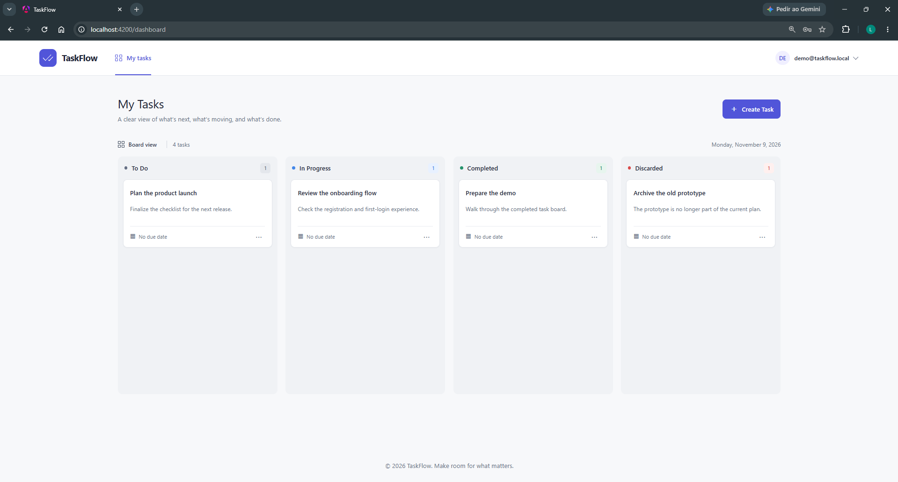

# TaskFlow

## CONTEXT

TaskFlow is a web-based task management application built around a Kanban board. This technical exercise demonstrates layered architecture, JWT authentication, frontend/backend integration, automated testing, and AI-assisted collaboration.

The solution consists of:

- Angular frontend
- ASP.NET Core Web API backend
- SQL Server database
- JWT bearer authentication
- Task management scoped to the authenticated user

The goal was to deliver a functional application for account registration, login, and personal task management, following the approved API contract and requirements.

---

## SETUP

### 1. PREREQUISITES

Make sure you have:

- Docker Desktop with Linux containers enabled
- .NET SDK 10
- Node.js and npm

### 2. COMMANDS

From the repository root, run:

```powershell
docker compose up --build
```

This starts the following services:

- Frontend: http://localhost:4200
- API Swagger: http://localhost:5004/swagger
- SQL Server: `localhost,1433`

Local development SQL Server credentials:

- Username: `sa`
- Password: `TaskFlow_dev_2026!`

Important notes:

- These credentials are for local development only.
- Database files are stored in a Docker volume and persist across container restarts.
- In Development, the API generates a temporary JWT signing key if `TASKFLOW_JWT_SIGNING_KEY` is not configured. Tokens become invalid when the API restarts.
- Production deployments must configure the signing key securely. Never commit signing keys or production credentials to the repository.

### 3. DEMO DATA

The application seeds a demo account in the Development environment:

- Email: `demo@taskflow.local`
- Password: `TaskFlowDemo2026!`

---

## USE CASES

### 1. USER REGISTRATION

The user opens the registration screen and provides only:

- Email
- Password
- Confirm password

The backend validates the password according to the configured policy.

Expected flow:

1. The user opens the registration page.
2. The user enters an email address and password.
3. The application validates the input.
4. The API creates the account.
5. The user proceeds to the login flow.


https://github.com/user-attachments/assets/b15825f4-d4d9-4c09-941b-b54693a91958


### 2. SIGN IN

The user enters their email and password on the login screen.

When the credentials are valid:

- The API returns a JWT access token.
- The frontend stores the token for the current browser session.
- The user is redirected to the dashboard.

When the credentials are invalid:

- The API returns `401 Unauthorized`.
- The interface displays a generic invalid-credentials message.


https://github.com/user-attachments/assets/a39c2d3e-20bd-4e9a-b363-461ac8934b91


### 3. SIGN OUT

The user opens the account menu in the dashboard and selects **Sign out**.

- The frontend clears the access token and account email from the browser session.
- The user is redirected to the login screen.
- Protected dashboard routes require authentication; after logout, the user must sign in again to access them.


https://github.com/user-attachments/assets/7632cb96-14ad-4bf6-a9a7-e958daee44de


### 4. DASHBOARD

After authentication, the user can access their Kanban board, which displays:

- The application header and signed-in account
- Tasks grouped by status
- A task count for each column
- An action to create a task
- Actions to edit or delete each task



### 5. TASKS

Users can manage their own tasks through the dashboard.

Key product rules:

- Each task belongs to the authenticated user.
- The client cannot choose or change the task's `userId`.
- The only allowed statuses are `Todo`, `InProgress`, `Completed`, and `Discarded`.
- New tasks are created with the `Todo` status.

#### 5.1 CREATE A TASK

The user creates a task by entering a title and, optionally, a description and due date. The API assigns the task to the authenticated user and sets its initial status to `Todo`.


https://github.com/user-attachments/assets/8f761d3e-9bbb-46cc-94e9-e5a1d7111946


#### 5.2 UPDATE A TASK

The user can edit a task's title, description, due date, and status. The selected status must be one of `Todo`, `InProgress`, `Completed`, or `Discarded`.


https://github.com/user-attachments/assets/690d7615-ca01-4630-98cf-4393252b5c2f


#### 5.3 DELETE A TASK

The user selects **Delete**, reviews the confirmation dialog, and confirms the action. Only tasks owned by the authenticated user can be deleted.


https://github.com/user-attachments/assets/b762a72a-2e96-4cf5-8ff9-e9c12751ed1d


---

## AI-ASSISTED DEVELOPMENT

The project used an AI-agent collaboration workflow organized around clear roles, approved requirements, and human review.

### 1. AGENTS

The main roles were:

- [Solution Architect / Domain Expert](./.github/agents/solution-architect.agent.md)
- [Backend Developer](./.github/agents/backend-developer.agent.md)
- [Frontend Developer](./.github/agents/frontend-developer.agent.md)
- [QA Engineer / Code Reviewer](./.github/agents/qa-reviewer.agent.md)

Each agent worked within its area of responsibility and followed the approved requirements and API contract.

### 2. INSTRUCTIONS

Project instructions and implementation guidance are documented in:

- [Requirements](./.github/docs/requirements.md)
- [API Contract](./.github/docs/api-contract.md)
- [Architecture](./.github/docs/architecture.md)
- [Agent Workflow](./.github/docs/agent-workflow.md)

These documents served as the source of truth for keeping the frontend, backend, and business rules aligned.

### 3. PROJECT DOCUMENTATION

Supporting documentation covers:

- Architecture
- API contracts
- Product decisions
- Agent collaboration workflow
- Figma visual reference

This helped make implementation decisions explicit and reduce inconsistencies between the specification and the code.

### 4. WORKFLOW EXAMPLE

Use cases were handled in stages:

1. The Solution Architect planned the work and clarified requirements.
2. The appropriate agent implemented the change.
3. QA and a human reviewer validated the result.
4. Follow-up changes addressed review findings and contract requirements.

For example, an authentication change could involve planning the API behavior, implementing the backend and login screen with the relevant agents, and then reviewing the contract and behavior.

### 5. PRACTICAL EXAMPLE

```text
i. Plan the task with the Solution Architect

ii. Assign the appropriate agent (backend, frontend, or QA reviewer)

iii. Review the result with a human
```

This workflow was used for registration and authentication, task creation and updates, authorization and ownership checks, edge-case review, and frontend/API consistency.

## FINAL DELIVERY

The application delivers the core requirements of the exercise:

- Account registration and authentication
- User-scoped task management
- A Kanban board with the four required statuses
- Frontend integration with the API contract
- Automated tests for critical behaviors
- A documented AI-assisted development and review workflow
